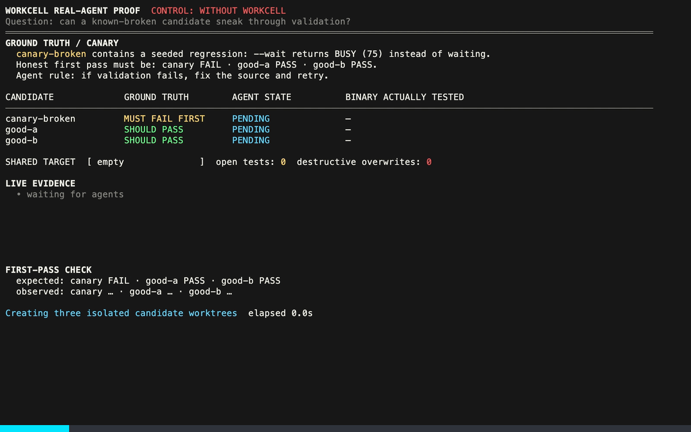

# Workcell

Workcell is a host-local FIFO queue for Macs, phones, GPUs, rigs, and license seats shared by coding agents.



## Install and use

```bash
curl -fsSL https://workcell-137.pages.dev/install.sh | sh

workcell run macos-xcode --wait -- xcodebuild test
```

Or tell your agent:

```text
install https://workcell-137.pages.dev/llms.txt
```

## Try it

Compare the same three-agent validation with and without Workcell:

```bash
curl -fsSL https://workcell-137.pages.dev/demo.sh | sh
```

## Commands

```text
workcell run <resource> [--wait] [--session <id>] [--json] -- <command...>
workcell status <resource> [--json]
```

- `resource` is the exact queue key; use one canonical name for each shared capability.
- `--wait` joins the FIFO queue. Without it, a busy resource exits `75`.
- `--json` emits one result on stdout, writes command output to `log_path`, and includes `owner`, `queue_ahead`, and `next_action.wait_argv` when busy.
- `--session` or `WORKCELL_SESSION` identifies the caller.

## Agent contract

Use Workcell only for a project’s named, host-local resource. Prefer the checked-in wrapper that owns its keys; do not invent one or add an outer reservation around a command that already reserves itself.

When a JSON run is busy, execute `next_action.wait_argv` unchanged only if the result is still needed, or continue unrelated work. Do not poll, bypass the queue, or terminate the owner. Multi-resource wrappers must acquire each key once in bytewise order; Workcell rejects same-key recursion and order inversion.

Completed results include the reservation, timings, log path, and wrapped exit code.

State is stored under `~/.local/state/workcell`. Set `WORKCELL_STATE_DIR` to override it.

Workcell coordinates cooperative callers on one host. It is not authorization, preemption, discovery, scheduling, or distributed locking.

## Origin

Workcell grew out of Pixel Brite, where parallel agents competed for a Mac and its simulators, an RTX 4090, and memory-constrained build hosts. A homegrown lease spread across several scripts worked well enough that I used coding agents to turn the pattern into Workcell.

The tradeoff is cooperation: every caller must use the same host, state root, and resource key.

## Development

```bash
make workcell-test
make demo
make multi-demo
make proof
```
